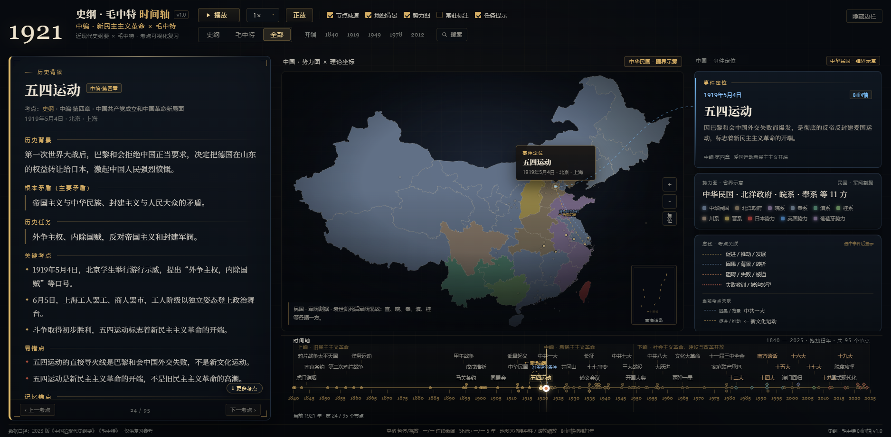

# 史纲 · 毛中特 时间轴

> 中国近现代史纲要 × 毛泽东思想和中国特色社会主义理论体系概论
> 交互式「地图 + 时间轴 + 考研考点卡 + 理论演进图谱」复习工作台

**在线预览：** https://bingshang04.github.io/history-axis/

一个零依赖、可离线运行的暗色学术工作台：拖动年份，地图按时期势力重着色，左侧同步给出教材章节考点，右侧给出事件定位与势力图；毛中特模式切换为五条理论主线的演进图谱。

[](LICENSE)


---

## 功能

### 史纲

- **1840–2025 时间轴**：74 个事件、22 个常显标签、30+ 考点关联边。
- **18 个时期势力着色**：清、太平天国、列强势力范围、军阀、国民政府、苏区、日占、抗日根据地、解放区、新中国、新时代。
- **地图 + 考点联动**：事件气泡、右侧事件定位卡、地图到卡片的蓝色定位虚线。
- **时间轴关系弧线**：选中事件后绘制其出边/入边关联，四种线型分别表示促进、因果、转折、阻碍；右栏「当前考点关联」列出实际类型与目标，可跳转。
- **考研考点卡**：历史背景 / 根本矛盾 / 历史任务 / 关键考点 / 易错点 / 记忆锚点，按教材上编/中编/下编章节标注。
- 播放：0.5× / 1× / 2× / 4×、正放/倒放、节点减速、端点自动暂停。
- 时间轴拖拽扫年；同时间点多个节点自动弹出考点选择器，避免点错。

### 毛中特

- **31 个理论节点 / 10 个理论专题 / 23 条关系边**。
- 五条理论泳道：毛泽东思想 → 邓小平理论 → “三个代表”重要思想 → 科学发展观 → 习近平新时代中国特色社会主义思想。
- `★` 标记「写入党章 / 确立为指导思想」节点；左侧可切换理论专题，专题卡可返回。

### 全部

- 史纲 + 毛中特独有节点合并到一条时间轴；同题同年的节点自动去重。
- 地图按史纲时期着色，理论节点以金色菱形出现。

### 通用交互

- 三个 tab、年份快捷跳转、隐藏边栏。
- 地图：滚轮以指针为中心缩放、拖拽平移、双击复位；缩放/平移后气泡和引导线跟随。
- 图例点击聚焦势力/理论主线。
- 搜索：`/` 或 `Ctrl/⌘+K`，标题相关度优先，搜索时自动暂停。
- 快捷键：空格、`←/→`、`Shift+←/→`、`Home/End`、`/`、`Esc`。
- URL 深链、浏览器前进/后退、`file://` 离线运行、`prefers-reduced-motion`。

### 手机 / 平板

- **桌面 ≥1200px**：三栏工作台。
- **平板 720–1199px**：两栏布局，左卡跨两行，地图与事件卡上下排列；右侧内容独立滚动。
- **手机 ≤719px**：单列纵向阅读，顺序为地图 → 事件卡 → 考点卡 → 时间轴；顶栏吸顶压缩。
- 手机时间轴支持横向滑动，点击节点弹出同时间点选择器；自动播放/跳年会把播放头滚入可视区。
- 毛中特在平板/手机上切换为**纵向理论节点列表**，避免五泳道图谱在窄屏缩成不可读的小图；桌面仍保留完整图谱。
- 触屏：点按 pin、时间轴节点、搜索项、图例均可操作；地图使用缩放按钮 + 拖动平移。

---

## 截图

| 史纲 1937 | 毛中特图谱 |
| --- | --- |
|  |  |

| 全部模式 | 1440 宽屏 |
| --- | --- |
|  |  |

| 手机 375px | 平板 768px |
| --- | --- |
|  |  |

关系弧线示例（甲午战争 → 洋务运动 / 《马关条约》）：


---

## 快速开始

### 直接打开（完全离线）

双击 `index.html`。所有数据以 `<script>` 内嵌，`file://` 下无需网络和服务器。

### 静态服务器

```bash
git clone https://github.com/bingshang04/history-axis.git
cd history-axis
python -m http.server 8765
# 打开 http://127.0.0.1:8765/
```

### 深链

```text
#tab=shigang&year=1856&uid=h:second-opium-war
#tab=shigang&year=1937
#tab=mao&year=2017
#tab=all&year=1949
```

---

## 数据与地图

- 史纲：74 条（上编 22 / 中编 28 / 下编 24），每条含完整考点卡、经纬度、章节、时间轴标签等级与关联边。
- 毛中特：31 节点、10 专题、23 关系边。
- 地图：DataV 省级边界 → **Miller 圆柱投影** → 简化内嵌 SVG；含 34 个省级单元、台湾/港澳、南海十段线插图。
- 地图数据由 `tools/build_geo.py` 生成，含 `bounds.mainland`、`bounds.scs` 与 `project(lon, lat)`。
- 数据契约见 [docs/DATA-SCHEMA.md](docs/DATA-SCHEMA.md)。

> 地图为示意级学习可视化：现代省界 + Miller 投影，历史疆界仅作注记；港澳面积过小，使用微标记与事件点补充。

---

## 目录结构

```text
history-axis/
├── index.html
├── css/app.css
├── js/
│   ├── util.js / data.js / map.js / theory.js
│   ├── timeline.js / panels.js / player.js / app.js
├── data/
│   ├── china-geo.js
│   ├── shigang-periods.js
│   ├── shigang-events.js
│   └── mao-data.js
├── tools/
│   ├── build_geo.py        # 地图生成
│   ├── verify_data.js      # 数据契约校验
│   ├── shot.js             # Playwright 截图
│   ├── qa.js / qa2.js      # 交互定向回归
│   ├── map_preview.html    # 地图独立预览
│   └── sync_plugin.mjs     # 同步到 DSH 插件
├── docs/
│   ├── DATA-SCHEMA.md
│   └── REFERENCE-SPEC.md
├── ds-plugin/              # DSH Harness 插件（Host + Client + web/）
├── screenshots/
├── README.md
└── LICENSE
```

---

## 开发

```bash
# 数据契约校验（应输出「通过（0 个警告）」）
node tools/verify_data.js

# 截图回归（需本地 8765 服务）
node tools/shot.js

# 定向 UX 回归
node tools/qa.js
node tools/qa2.js

# 重新生成地图（默认 Miller；可 --projection albers|mercator|equirect）
python tools/build_geo.py
```

依赖：Node.js 18+、Python 3.10+（仅地图生成/可选的 Playwright 截图）。运行应用本身零依赖。

---

## DSH Harness 插件

`ds-plugin/` 提供 Harness 插件入口：

- Host：注册 `/history-axis/` 静态路由，并提供 `webserver/index-inject` / `tapIndex` 兜底浮层。
- Client：在 `sidebar.panellist` 增加「时间轴」图标，`main` 面板用 iframe 打开 `/history-axis/`。
- 安装（本地链接）：

```powershell
node tools/sync_plugin.mjs
dsh plugin --profile desktop add link:"$PWD/ds-plugin"
```

安装后刷新页面或重启 Harness；未加载 Client 模块时右侧「时轴」悬浮入口可兜底。

---

## 已知限制

- 时间轴覆盖 1840–2025 全量范围，标签密度高于参考图的 50 年局部窗口；已用多行标签、常显等级、同时间点选择器补偿。
- 理论图谱共享一条时间轴，1921–1935 与 2012–2025 节点天然密集；采用泳道 + 多行标签 + 悬停详情。
- 地图为现代省界示意，不是历史测量边界；十段线/南海诸岛只在右下角插图展示。
- 虎门销烟：史实 1839 年 6 月，`year` 锚定 1840 以保留时间轴起点，卡片与 tooltip 显示真实日期。
- 内容面向 2023 版考研教材口径，属于个人复习工具，非官方教材或考试机构产品。

---

## 数据来源与许可

- 代码、自撰内容：MIT，见 [LICENSE](LICENSE)。
- 地图底图：DataV.GeoAtlas 行政区边界，按其使用条款使用。
- 内容口径参考 2023 版《中国近现代史纲要》《毛泽东思想和中国特色社会主义理论体系概论》、2021 年《中共中央关于党的百年奋斗重大成就和历史经验的决议》及公开官方资料。
- 参考图仅用于视觉研究，未包含在此仓库中；仓库内截图均为本项目运行画面。
